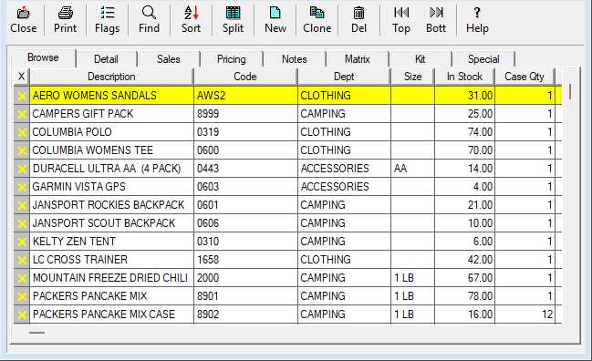

# Retail Plus Lite — Static Recompilation

Static recompilation of **Retail Plus Lite** (Retail Software, 2003), a
point-of-sale and inventory program for small shops, from its shipping Win32
executable `PLUSLITE.EXE` to native C. It is pcrecomp's first **CA-Visual
Objects** program: Retail Plus's own VO-compiled code is lifted to C and run on
pcrecomp's `native32` host, while the Visual Objects runtime DLLs it ships
(`CAVORT20`, `CAVO2GUI`, `CAVO2RDD`, ...) run as they are and call back into
the lifted code. No emulator, no wrapper DLLs.

Built on the [pcrecomp](https://github.com/sp00nznet/pcrecomp) toolchain, on
its `main` branch (which has the Clickteam installer extractor and the catalog
fixes this program needed).

## Getting Started

You need **your own copy**: the `Rp_lite.exe` shareware installer (Tucows
341566; the Internet Archive has it as
`tucows_341566_Retail_Plus_Lite_POS_Software`), or a folder holding
`PLUSLITE.EXE`. Nothing of Retail Plus is in this repository or downloaded for
you; the installer is unpacked, never run, and everything is built on your
machine from your copy. Windows only for now (`setup.sh` says so and exits).

### The setup scripts

1. Download this repository (the green **Code** button, then **Download ZIP**)
   and unzip it somewhere with 3 GB free.
2. Double-click **`Setup.cmd`** and give it `Rp_lite.exe` when it asks
   (`Setup.cmd -GameDir C:\path\Rp_lite.exe` skips the question).
3. Run it with the **`Retail Plus Lite`** shortcut in that folder.

The script asks before installing anything (Python 3.10+, `pefile` and
`capstone`, git, the Visual Studio 2022 C++ Build Tools), fetches pcrecomp
`main` beside this folder, then unpacks, catalogs, lifts
and builds. The first run takes about 80 minutes (catalog 9, lift 32, build
40); a rerun skips finished steps, and the details are in `setup.log`. Building
by hand is in **[docs/building.md](docs/building.md)**.

## Status

**v0.1.0, alpha.** The conformance harness (`tools/pos_diff.py`) runs one
script on the original and on the recomp: add a product, ring up a sale,
export the inventory. **11 of 11 outputs are identical** (every DBF table it
touches and the CSV export). That script is all the harness proves; the rest
of the program (clients, receiving, reports, backup) is untested.

| | |
|---|---|
| Functions found (`disasm32 --tail-jumps`) | 40,826 (95.8% of the code) |
| Lifted to C | 41,580 + 19 seeds, 0 errors |
| Imports bound | 4,816, 0 unresolved |
| Harness (`tools/pos_diff.py`) | 11 of 11 identical |

[docs/bringup.md](docs/bringup.md) is the log of each wall and its fix, and
[ROADMAP.md](ROADMAP.md) what comes next.

## Screenshots

The inventory, running as recompiled code, after the harness's sale (above).
More shots come with the headless mode on the ROADMAP.

## Documentation

- [docs/building.md](docs/building.md): building by hand, step by step, and the host's flags
- [docs/testing.md](docs/testing.md): the conformance harness
- [docs/bringup.md](docs/bringup.md): every wall so far and its fix, and how the VO runtime is called
- [ROADMAP.md](ROADMAP.md), [CHANGELOG.md](CHANGELOG.md), [CONTRIBUTING.md](CONTRIBUTING.md)

## Contributors

See **[CONTRIBUTORS.md](CONTRIBUTORS.md)** for who did what.

## License

MIT for this repository's own code ([LICENSE](LICENSE)). Retail Plus Lite is
© Retail Software and the Visual Objects runtime © Computer Associates; none of
their files, and nothing generated from them, is in this repository
([NOTICE.md](NOTICE.md)).
